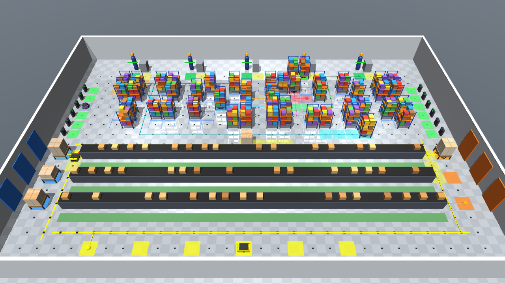
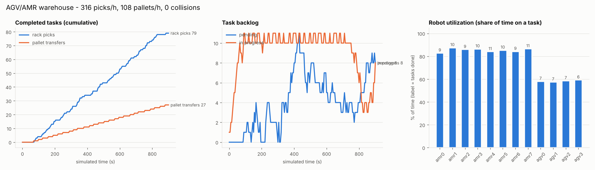
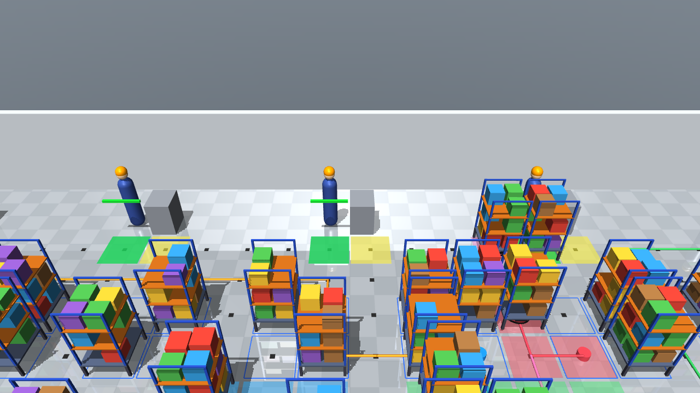

# AGV / AMR 물류센터 시뮬레이션 (MuJoCo)

산업 현장의 **자율주행 물류 로봇(AGV·AMR)** 여러 대가 물류센터 안에서 화물을 운반하는 과정을
MuJoCo 물리 시뮬레이션으로 구현한 프로젝트입니다. 창고 레이아웃, 로봇의 기구·구동, 경로계획,
교통관리(충돌·교착 방지), 작업 할당(관제 시스템), 배터리 관리, KPI 측정까지 한 번에 동작합니다.



## 시나리오

| 구역 | 내용 |
|---|---|
| **보관 구역 (상단)** | 2×2 블록 16개, 64개 슬롯에 이동식 선반(rack) 48개 |
| **피킹 스테이션 (최상단)** | 작업자 5명. AMR이 선반을 작업자 앞까지 가져다 줌 (Goods-to-Person) |
| **AMR 충전소 (좌·우 벽)** | 12개. AMR의 대기·충전 위치 |
| **AGV 루프 (하단)** | 자기 테이프로 된 일방통행 순환 경로. 좌측 입고 도크 3곳 → 우측 출고 도크 3곳 |
| **컨베이어 구역** | 루프 내부의 고정 설비 (통행 불가) |
| **AGV 주차장 (최하단)** | 6곳. AGV 대기·충전 |

### 두 종류의 로봇

| | **AMR** (Autonomous Mobile Robot) | **AGV** (Automated Guided Vehicle) |
|---|---|---|
| 형태 | 원형 리프트형 (Kiva/Geek+ 타입) | 사각형 리프트형 |
| 주행 | 격자 위 **자유 경로계획** (A*) | **자기 테이프 위에서만** 정해진 방향으로 주행 |
| 작업 | 선반 슬롯 → 들어올림 → 피킹 스테이션(대기열) → 피킹 → 원래 슬롯 → 내려놓음 | 입고 도크 팔레트 → 들어올림 → 출고 도크 → 내려놓음 → 트럭 출하 |
| 교착 시 | 우회 경로 재계획 또는 옆 칸으로 비켜줌 | 테이프를 벗어날 수 없으므로 대기 (AMR이 양보) |

두 로봇 모두 차동구동(differential drive)으로 제어되고, 리프트(상하) + 턴테이블(회전)을 갖습니다.
로봇이 제자리 회전을 해도 턴테이블이 반대로 돌아서 실은 선반의 방향은 그대로 유지됩니다.

## 시스템 구성

```
run_sim.py                 실행 진입점 (viewer / headless / video)
logistics_sim/
├── layout.py              창고 격자 지도 (1 m 셀), AMR 이동 그래프, AGV 테이프 방향 그래프
├── scene.py               MJCF(XML) 자동 생성: 바닥·벽·설비·작업자·로봇·선반·팔레트
├── planner.py             회전 비용을 반영한 A* (상태 = 셀 + 진행 방향)
├── traffic.py             셀 예약 기반 교통관리 + wait-for 그래프로 교착 감지
├── robot.py               로봇 온보드 제어기: 작업 스크립트 실행, pure-pursuit 주행, 리프트
├── fleet.py               관제(FMS) + 창고관리(WMS): 주문 생성, 작업 할당, 배터리, KPI
├── viz.py                 경로·예약 셀 오버레이, HUD, 동영상 녹화
└── report.py              KPI 그래프 (matplotlib)
tests/test_sim.py          단위·통합 테스트
```

### 동작 원리

1. **주문 생성 (WMS)**: 포아송 과정으로 주문이 발생하면 해당 상품이 있는 선반을 고르고, 입고 도크에
   팔레트가 있고 비어 있는 출고 도크가 있으면 이송 작업을 만듭니다.
2. **작업 할당 (FMS)**: 대기열이 가장 짧은 피킹 스테이션을 고르고, 배터리가 충분한 유휴 로봇 중
   가장 가까운 로봇에게 작업 스크립트(`goto → lift → station → dwell → goto → lower`)를 내려보냅니다.
3. **경로계획**: AMR은 실은 짐이 있으면 다른 선반 밑을 통과할 수 없고, 빈 상태에서는 선반 밑을 지나갈 수
   있습니다(비용 가중). AGV는 테이프의 방향 그래프 위에서만 계획합니다.
4. **교통관리**: 로봇은 다음 칸들을 미리 **예약**한 뒤에만 진입하고, 차체와 짐이 완전히 빠져나가면 예약을
   풉니다. 그래서 두 로봇이 같은 칸에 동시에 있을 수 없습니다. 오래 기다리게 되면 wait-for 그래프에서
   순환을 찾아 우회 경로로 다시 계획하거나 옆 칸으로 비켜서 교착을 풉니다.
5. **물리**: 로봇 베이스는 속도 액추에이터, 리프트·턴테이블은 위치 액추에이터로 움직입니다. 리프트가
   선반을 실제로 접촉해서 들어올린 뒤 weld 구속을 켜서(실제 로봇의 고정 핀 역할) 운반합니다.
6. **배터리**: 주행 거리와 적재 여부에 따라 소모되고, 25% 미만이면 충전소로 돌아가 60%까지 충전합니다.
   LED 색이 상태를 나타냅니다 (초록 대기 / 파랑 주행 / 노랑 대기·정체 / 주황 작업 / 하늘색 충전 / 빨강 배터리 부족).

## 설치 및 실행

```bash
pip install -r requirements.txt

# 3D 뷰어 (디스플레이 필요, 실시간; --speed 4 로 4배속)
python run_sim.py --mode viewer

# 화면 없이 15분 시뮬레이션 → results/kpis.json, events.log, kpis.png
python run_sim.py --mode headless --duration 900 --plot

# 동영상 녹화 (서버에서는 MUJOCO_GL=egl 또는 osmesa)
MUJOCO_GL=egl python run_sim.py --mode video --duration 180 --video results/warehouse.mp4

# 로봇 대수, 주문 빈도 바꾸기
python run_sim.py --mode headless --amr 12 --agv 6 --order-interval 6

# 테스트
python -m pytest -q
```

주요 옵션: `--amr`(최대 12), `--agv`(최대 6), `--order-interval`(평균 주문 간격, 초), `--pick-time`,
`--camera overview|top|pick_area`, `--timelapse`(동영상 1초당 시뮬레이션 초), `--export-xml scene.xml`.

창고 레이아웃은 `logistics_sim/layout.py`의 `DEFAULT_MAP` 문자열을 고치면 바뀝니다
(`S` 보관 슬롯, `P`/`Q` 피킹 스테이션/대기 칸, `C` 충전소, `T` AGV 테이프, `I`/`O` 입·출고 도크, `A` AGV 주차).

## 결과 예시

기본 설정(AMR 8대, AGV 4대, 평균 10초마다 주문 1건)으로 15분 시뮬레이션한 결과:

| 지표 | 값 |
|---|---|
| 발생 주문 / 완료 피킹 | 92건 / 79건 (시간당 316건) |
| 팔레트 입·출고 이송 | 27건 (시간당 108건) |
| 평균 리드타임 (주문 → 선반 복귀) | 피킹 113초, 팔레트 74초 |
| AMR 가동률 | 83 ~ 88% |
| **충돌** | **0건** (정체 시 우회 재계획 141회로 교착 없이 운영) |
| 시뮬레이션 속도 | 실시간의 약 4.3배 (CPU 1코어, 화면 없음) |

평균 7초마다 주문이 들어오면 AMR 8대로는 처리 능력(시간당 약 350건)을 넘어서 대기 작업이 계속 쌓입니다.
`--amr 12`로 대수를 늘리면 해소됩니다. 이렇게 대수·레이아웃·주문량을 바꿔 가며 설비 용량을 검토할 수 있습니다.

데모 영상: [`docs/demo.mp4`](docs/demo.mp4) (시뮬레이션 180초를 4배속으로 녹화, 상단에 실시간 KPI 표시,
바닥의 색 선 = 각 로봇의 계획 경로, 반투명 사각형 = 예약된 셀)




